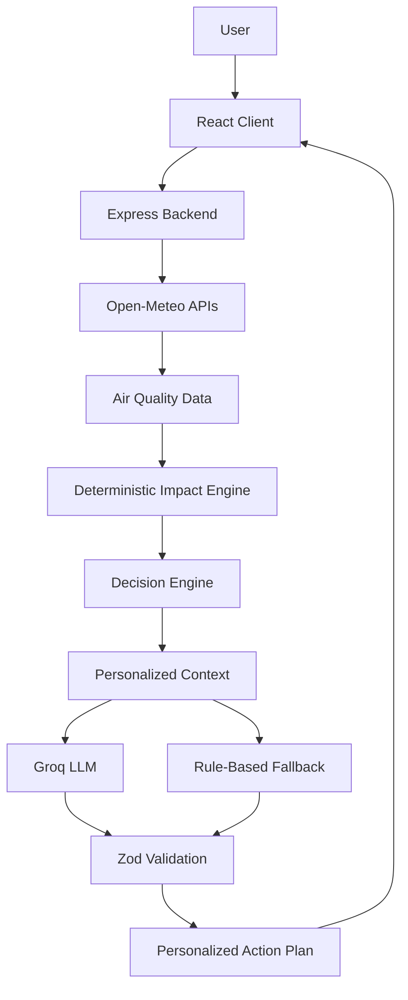

# AirWise | Breathe Better. Live Smarter.

**An AI-powered air quality companion helping families make healthier, smarter decisions in polluted environments.**

AirWise combines real-time air quality monitoring, personalized recommendations, and transparent impact calculations to help individuals and communities navigate urban air pollution and severe winter smog.

It goes beyond displaying AQI numbers by turning environmental data into practical, affordable, and actionable daily routines.

---

## Overview

Air pollution affects everyday decisions, from when we open our windows to how we commute, cook, and protect our families.

AirWise addresses this problem through a hybrid AI system that combines deterministic environmental calculations with Generative AI to provide recommendations tailored to a household's location, lifestyle, and needs.

**What makes AirWise different?**

- Recommendations are backed by deterministic calculations rather than AI-generated statistics.
- Personalized plans adapt to household conditions and pollution levels.
- A built-in rule engine ensures recommendations remain available even when the AI service is unavailable.
- Designed for accessibility, affordability, and practical use by families and communities.

## Key Features

### 1. Real-Time Air Quality Monitoring
- Live PM2.5, PM10, and US AQI monitoring.
- 24-hour air quality forecasts.
- Identification of the best ventilation windows and high-pollution periods.
- Location detection and city-based search.
- Dynamic pollution alerts.

### 2. AI-Powered Personalized Recommendations
- Tailored morning, afternoon, and evening routines.
- Indoor air quality improvement suggestions.
- Sustainable commuting and cooking alternatives.
- Recommendations based on household size, commute, home type, and sensitive family members.
- AI-powered conversational assistant for air quality queries.

### 3. Intelligent Decision Engine
AirWise uses a multi-attribute decision model to prioritize recommendations based on:

- Environmental impact
- Feasibility
- Implementation effort
- Household-specific rules

Users receive their three highest-priority actions along with an explanation of why those actions were selected.

### 4. Transparent Impact Calculations
- Daily pollution exposure estimates.
- PM2.5 cigarette-equivalence estimates.
- Weekly CO2e savings from sustainable alternatives.
- Interactive What-If slider to explore potential improvements.

All numerical calculations are handled by a deterministic mathematical engine. The LLM is responsible for personalization and explanations, not generating impact statistics.

### 5. Built for Real-World Accessibility
- English, Hindi, and Telugu language support.
- Simple Mode with larger text and simplified recommendations.
- Light, Dark, and High-Contrast themes.
- Accessible AQI indicators and chart alternatives.
- Printable household checklists.
- WhatsApp and plain-text community sharing.
- PWA offline support with cached plans.

---

## How It Works

AirWise follows a hybrid AI architecture that separates numerical computation from language generation.



**The two core processing layers:**

| Component | Responsibility |
|---|---|
| Deterministic Engine | Calculates exposure, AQI categories, environmental impact, and action metrics. |
| GenAI Layer | Personalizes recommendations and explains them in accessible language. |
| Decision Engine | Prioritizes actions using impact, feasibility, effort, and household rules. |
| Rule-Based Fallback | Generates localized recommendations when the AI service is unavailable. |

If the Groq API is unavailable, times out, or returns an invalid response, AirWise automatically falls back to its deterministic recommendation engine.

---

## Technology Stack

| Layer | Technologies |
|---|---|
| Frontend | React 18, TypeScript, Vite |
| Backend | Node.js 20, Express, TypeScript |
| Shared Logic | TypeScript, Zod |
| AI Integration | Groq API, Llama 3.3 70B |
| Data Sources | Open-Meteo Air Quality and Geocoding APIs |
| Visualization | Recharts |
| Testing | Vitest, Supertest, Playwright |
| Accessibility | vitest-axe |
| Architecture | npm Workspaces, PWA |

---

## Project Structure

```text
AirWise/
│
├── client/                 # React frontend
│   ├── src/
│   │   ├── components/
│   │   └── ...
│   └── public/
│
├── server/                 # Express backend
│   └── src/
│       ├── services/
│       ├── middleware/
│       └── prompts/
│
├── shared/                 # Shared business logic
│   └── src/
│       ├── engine/
│       ├── schemas.ts
│       └── actions.ts
│
├── docs/                   # Documentation and ADRs
├── e2e/                    # End-to-end tests
│
├── .env.example
├── package.json
├── playwright.config.ts
└── tsconfig.base.json
```

---

## Getting Started

### Prerequisites

- Node.js >= 20
- npm >= 9

### 1. Clone the repository

```bash
git clone https://github.com/Akhila636636/AirWise.git
cd AirWise
```

### 2. Install dependencies

```bash
npm install
```

### 3. Build the shared package

```bash
npm run build -w shared
```

### 4. Configure environment variables

Create a `.env` file in the project root using `.env.example`.

```bash
cp .env.example .env
```

Configure the following variables:

```env
GROQ_API_KEY=your_groq_api_key
GROQ_MODEL=llama-3.3-70b-versatile

PORT=3001
CORS_ORIGINS=http://localhost:5173
NODE_ENV=development
```

The Groq API key is optional. Without it, AirWise uses its rule-based recommendation engine.

### 5. Start the application

```bash
npm run dev
```

The application will be available at:

- **Frontend:** http://localhost:5173
- **Backend:** http://localhost:3001

### Demo Mode

To explore the application with preconfigured severe pollution conditions, open:

```text
http://localhost:5173/?demo=1
```

This loads a simulated Delhi smog scenario with preconfigured household details and recommendations.

---

## API Reference

| Endpoint | Method | Description |
|---|---|---|
| `/api/health` | GET | Backend health check |
| `/api/geocode` | GET | Location search |
| `/api/air` | GET | Air quality data |
| `/api/plan` | POST | Generates a personalized action plan |
| `/api/chat` | POST | AirWise conversational assistant |

### Request Overview

**Generate a Plan**

`POST /api/plan`

Accepts household profile, location, and optional manual AQI information.

**Ask AirWise**

`POST /api/chat`

Accepts conversation messages, household profile, current AQI, and plan context.

---

## Engineering & Reliability

### Security
- API keys isolated on the backend.
- Helmet security headers and Content Security Policy.
- Strict CORS configuration.
- Rate limiting on sensitive endpoints.
- Input sanitization and prompt-injection protection.
- No database or centralized storage of household profiles.

### Performance
- In-memory caching with a 15-minute TTL for air quality data.
- Lazy-loaded forecast visualizations.
- Lightweight frontend bundle.
- Stateless backend architecture.

### Accessibility
- WCAG 2.2 AA accessibility targets.
- Keyboard navigation and screen-reader announcements.
- High-contrast theme.
- Accessible alternatives to graphical forecasts.
- Multilingual support.

### Testing

Run the following commands to verify the project:

```bash
# TypeScript validation
npm run typecheck

# Linting
npm run lint

# Run tests
npm test

# Test coverage
npm run test:coverage

# Production build
npm run build
```

---

## Impact Model & Limitations

AirWise uses documented environmental assumptions and transparent mathematical calculations.

Its impact model includes:
- PM2.5 exposure estimates.
- Indoor/outdoor infiltration ratios.
- Respiratory protection assumptions.
- Cooking fuel emission multipliers.
- Transport-related CO2e estimates.

These calculations are educational approximations intended to support pollution awareness and harm reduction.

**AirWise is not a medical diagnostic tool and does not replace professional medical advice.**

---

## Documentation

For additional technical details:

- [Security Guidelines](SECURITY.md)
- [Contribution Guidelines](CONTRIBUTING.md)
- [Accessibility Documentation](docs/ACCESSIBILITY.md)
- [Architecture Decision Records](docs/decisions/)

---

## Project Vision

AirWise aims to make air quality information more understandable and actionable.

By combining environmental data, deterministic decision-making, and Generative AI, it helps families move from simply knowing that the air is polluted to understanding what they can realistically do about it.

**Better decisions. Healthier routines. Cleaner communities.**

---

